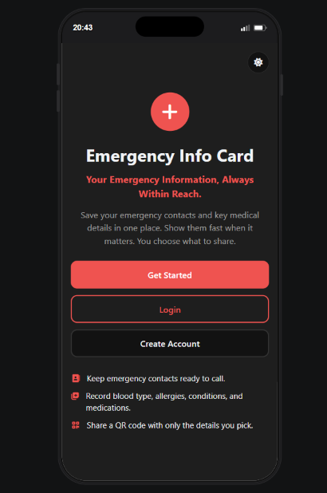
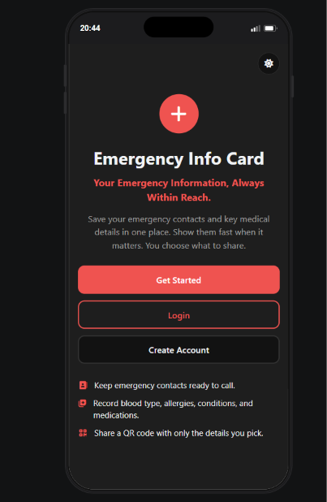
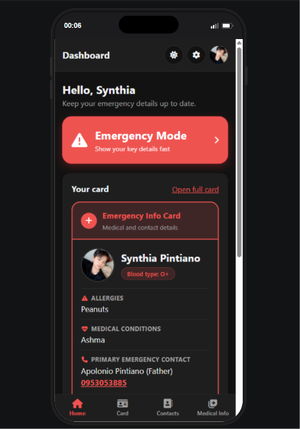
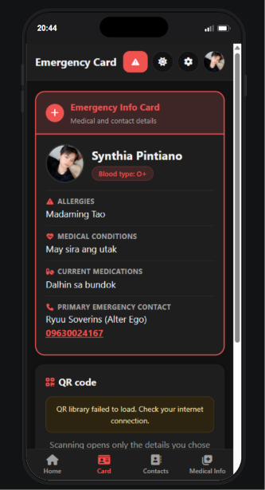
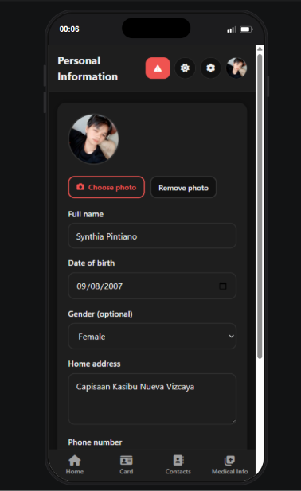
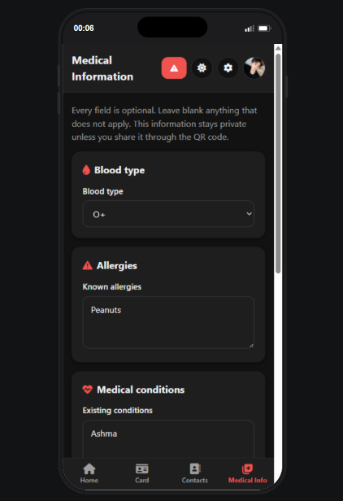
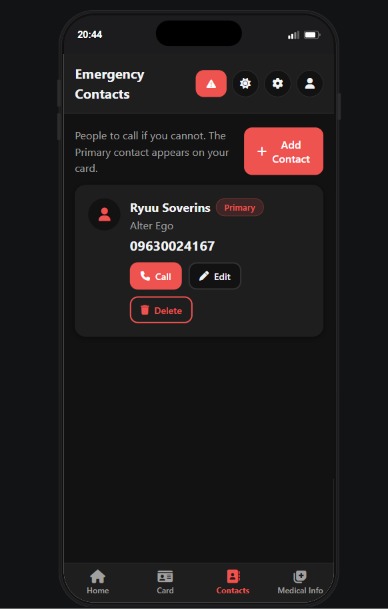
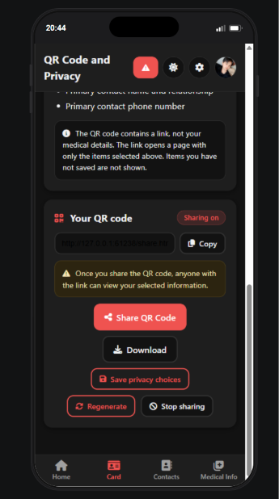
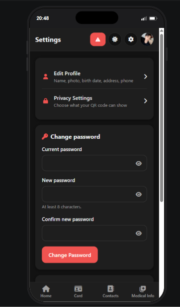

# Emergency Info Card

A responsive web application designed to store critical medical details and emergency contacts in one secure place. Users can display vital health information quickly during emergencies via a dedicated **Emergency Mode** or share selected details publicly using a privacy-controlled QR Code.

---

## Features

- **User Authentication & Account Security:** Email/password registration, login, password reset, password updates, and permanent account deletion powered by Firebase Authentication.
- **Personal & Medical Profiles:** Store full name, profile photo (automatically cropped and resized), date of birth, blood type, allergies, medical conditions, current medications, and medical notes.
- **Emergency Contacts Management:** Add, edit, and delete emergency contacts with one-tap calling and automatic Primary vs. Secondary contact prioritization.
- **Emergency Mode:** High-contrast, large-text emergency screen displaying critical information (Name, Blood Type, Allergies, Conditions, and a direct Primary Contact call button) for rapid access by first responders.
- **Privacy-Controlled QR Code Sharing:**
  - Generate a unique, revocable share link and downloadable QR code.
  - Granular privacy toggles let users choose the exact fields visible on the public shared card (`pages/share.html`).
  - Regenerate tokens or turn off sharing at any time to immediately revoke public access.
- **Printable Emergency Card:** Clean, print-friendly layout for keeping a physical copy in a wallet or bag.
- **Light & Dark Mode:** Automatic system theme detection with a manual light/dark mode toggle.

---

## Screenshots

### 1. Landing Page & Login

| Landing Page | Login Page |
| :---: | :---: |
|  |  |

### 2. User Dashboard & Full Emergency Card

| User Dashboard | Full Emergency Card |
| :---: | :---: |
|  |  |

### 3. Personal & Medical Information

| Personal Information | Medical Information |
| :---: | :---: |
|  |  |

### 4. Emergency Contacts, QR Code & Settings

| Emergency Contacts | QR Code & Privacy | Account Settings |
| :---: | :---: | :---: |
|  |  |  |

---

## Tech Stack

- **Frontend:** HTML5, CSS3 (Custom Properties & Responsive Grid/Flexbox), Vanilla JavaScript (ES Modules)
- **Backend & Database:** Firebase Authentication, Cloud Firestore, Firebase Hosting
- **Libraries:** Font Awesome (icons), QRCode.js (client-side QR generation)

---

## How to Install and Run

### Prerequisites
- A [Firebase](https://google.com) project with **Authentication** (Email/Password provider) and **Cloud Firestore** enabled.
- [Node.js](https://nodejs.org) and the [Firebase CLI](https://google.com/docs/cli) (optional, for local hosting or deployment).

### Setup Instructions

1. **Clone the repository:**
   ```bash
   git clone https://github.com<your-username>/<your-repo-name>.git
   cd <your-repo-name>
   ```

2. **Configure Firebase:**
   - Open `js/firebase-config.js` and replace the `firebaseConfig` object with your Firebase project credentials.
   - Update `.firebaserc` so `"default"` matches your Firebase project ID.

3. **Deploy Firestore Security Rules:**
   - Copy the contents of `firestore.rules` into your Firebase Console under **Firestore Database > Rules** and click **Publish**, or deploy via CLI:
   ```bash
   firebase deploy --only firestore:rules
   ```

4. **Run Locally:**
   - **Option A (Firebase CLI):**
     ```bash
     firebase serve
     ```
   - **Option B (Python / VS Code Live Server):**
     ```bash
     python -m http.server 8000
     ```
   - Open `http://localhost:8000` in your browser.

---

## Author

- **Name:** Synthia Macasling Pintiano
- **Section:** BSINTE 2C
